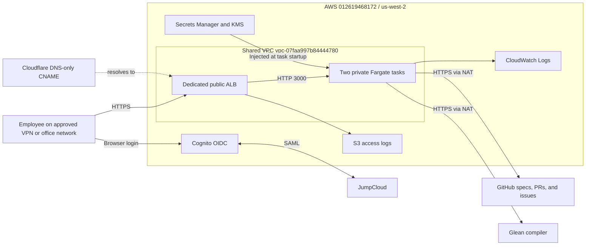
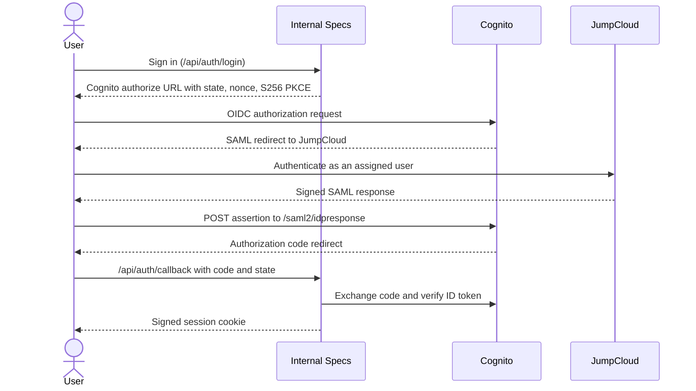

# Architecture and AWS Setup

AI Spec Explorer is a stateless Next.js 15 application. GitHub stores Markdown
specifications and change history; Glean compiles them into structured answers.
The production baseline below was verified on **2026-10-22**. See the
[master plan](docs/deployment-master-plan.md#current-deployment-snapshot) for the
dated release SHA, image digest, and task revision rather than treating those
identifiers as permanent configuration.

## System overview

The ALB terminates TLS and forwards only the expected hostname. Authentication
runs in the application; this is not an ALB `authenticate-oidc` deployment.
The browser follows the Cognito/JumpCloud redirects described below.

## Application components and data flow

| Component | Responsibility |
| --- | --- |
| `app/page.tsx`, `components/SpecWorkspace.tsx` | Access-controlled page and browser workspace state. |
| `app/api/`, `lib/auth/` | API validation, OIDC login/callback, sessions, origin checks, and access policy. |
| `lib/compiler.ts`, `lib/json.ts`, schemas | Provider-neutral prompts, rule citations, JSON parsing/validation, and one corrective retry. |
| `lib/providers/` | Glean compiler, separate optional company-knowledge lookup, and optional Bedrock Converse transport. |
| `lib/github.ts` | GitHub reads, history, branches, commits, and pull requests. |
| `lib/spec-retrieval.ts`, `lib/federated-retrieval.ts` | Single-spec and cross-team lexical retrieval; no vector database. |
| `lib/resolve-spec-path.ts`, `lib/spec-paths.ts` | Confine paths to `SPEC_ROOT` and resolve each child's owning parent. |
| `lib/gaps.ts`, `lib/cross-team.ts`, `lib/followers.ts` | GitHub-backed reports and follower handling. |

Reads load the selected repository content. Ask retrieves relevant rules;
compilation validates provider output before returning it. Editor drafts live
in browser memory. Saving/uploading/initializing specs proposes GitHub PRs;
gap and cross-team reporting creates issues. The service token performs GitHub
operations and signed-in identity supplies attribution. GitHub branch protection
applies to these PRs as it does to code PRs.

All assigned users can work across registered teams. Path confinement and
owning-parent resolution prevent unintended path selection; they do not grant
different employees different team roles. See [multi-team behavior](docs/multi-team.md).

## AWS resources and ownership

| Stack | Owned resources |
| --- | --- |
| `internal-specs-foundation` / `infra/foundation.yaml` | ALB/listener/target group, security groups, ECR, runtime secret, KMS key, logs, task/execution roles. |
| `internal-specs-service` / `infra/service.yaml` | Fargate task definition/service and metric alarms; optional SNS/EventBridge routing. |
| `internal-specs-cognito` / `infra/cognito.yaml` | Dedicated user pool, confidential OIDC client, Hosted UI domain, and JumpCloud SAML IdP. |
| `internal-specs-ci` / `infra/ci.yaml` | GitHub OIDC deployment role. |

The shared VPC, subnets, NAT gateways, `wyze-internal` ECS cluster, wildcard ACM
certificate, and account GitHub OIDC provider predate this service. Application
stacks reference them; they do not own or replace them.

| Setting | Production value |
| --- | --- |
| Account / region | `012619468172` / `us-west-2` |
| VPC / cluster / service | `vpc-07faa997b84444780` / `wyze-internal` / `internal-specs` |
| Capacity | Two Linux x86_64 Fargate tasks; 0.5 vCPU and 1 GiB each; no autoscaling configured. |
| Public ALB | `wyze-internal-specs`; HTTPS 443 with existing `*.wyze.com` ACM certificate; no HTTP listener. |
| DNS target | `wyze-internal-specs-1589150793.us-west-2.elb.amazonaws.com` |
| Image repository | `012619468172.dkr.ecr.us-west-2.amazonaws.com/internal-specs`; immutable tags, scan on push. |
| Runtime secret | `/internal-specs/prod/runtime`; ECS resolves individual JSON keys at task startup. |
| Application logs | `/ecs/internal-specs`; 30-day retention, customer-managed KMS encryption. |
| ALB logs | `internal-specs-alb-logs-012619468172-us-west-2`; private, versioned, SSE-S3; current objects expire after 30 days. |
| KMS alias | `alias/internal-specs/prod`; rotating key protects the secret, ECR, and application logs. |

### Network boundary

| AZ | Public ALB subnet | Private task subnet |
| --- | --- | --- |
| `us-west-2a` | `subnet-0a51f4bb0e2f2638d` | `subnet-06b338c1440dbb2fe` |
| `us-west-2b` | `subnet-0986aff5d00b4a2a8` | `subnet-06b5d9cd8e4361625` |

The ALB is internet-facing but accepts 443 only from the six approved VPN/office
`/32` sources in `infra/foundation.yaml`. Tasks have no public IP and accept
port 3000 only from the ALB security group. Outbound HTTPS uses existing NAT;
it is not restricted by destination domain. Unmatched hostnames receive 404.

Cloudflare holds a **DNS-only**, unproxied CNAME with TTL 300. DNS changes go
through [wyze-dns-config](https://github.com/wyzelabs-inc/wyze-dns-config) PRs and
that repository's production workflow; do not apply DNS locally.

## Authentication and sessions

- User pool: `us-west-2_Q18L1whbh`; client: `35vi4dlcdhefcc8pvq56jp8nh3`.
- Issuer: `https://cognito-idp.us-west-2.amazonaws.com/us-west-2_Q18L1whbh`.
- Hosted UI: `https://internal-specs-012619468172.auth.us-west-2.amazoncognito.com`.
- Application callback: `https://internal-specs.wyze.com/api/auth/callback`.
- JumpCloud group: `wyze-internal-specs-users`; only the dedicated `jumpcloud`
  SAML provider is enabled. Native self-signup is disabled.
- Verified SAML mappings are `email` → `email` and `name` → `name`. The app
  restricts email domains to `wyze.com`. JumpCloud controls group assignment/MFA.

Sessions are eight-hour signed JWT cookies: Secure, HttpOnly, SameSite=Lax, with
one `SESSION_SECRET` shared across tasks. No sticky sessions or session database
are needed. Logout clears the local cookie; group removal does not immediately
revoke an issued application session. See [SSO setup](docs/cognito-sso.md) for IT
metadata, SP audience, ACS URL, and operator verification.

## Integrations, secrets, and persistence

Production uses `COMPILER_PROVIDER=glean`, `GLEAN_AGENT=GPT`, and
`GLEAN_COMPANY_KNOWLEDGE=false`. Glean is the model transport; the spec-only
prompt/retrieval path does not use Glean's company search. Enabling the separate
knowledge panel uses Glean's existing indexed content, not direct app connections
to Slack, Jira, or Confluence. Bedrock support exists in code but is not enabled;
the deployed task role has no Bedrock invocation permission.

There is **no database, Redis, EFS, or vector store**. Specifications, follower
files, history, PRs, and issues persist in GitHub. Drafts are browser-local;
session tokens are cookies; provider token caches and rate limits are per process.
Compile limits are 20/minute, Ask 40/minute, with an additional 15/minute limit
for federated Ask; multiple replicas do not share counters.

The execution role can pull this ECR image, publish logs, and read/decrypt the
runtime secret. The application task role has no additional AWS permissions.
`GLEAN_TOKEN` is the Secrets Manager field injected as `GLEAN_API_KEY`; these
names are intentionally different. Secret changes require replacement tasks.
See [configuration](docs/configuration.md) for all mappings. Do not log secret
values; restrict ALB log access because callback URLs can contain codes/state.

## Delivery and operations

```mermaid
flowchart LR
  Local[Topic branch and local checks] --> PR[Open PR]
  PR --> Gate[application + infrastructure + PR gate]
  Gate --> Merge[Squash merge to main]
  Merge --> Check[Main validation]
  Check --> Build[OIDC role: build and scan ECR image]
  Build --> Change[Image-only CloudFormation change set]
  Change --> Deploy[ECS rolling deployment]
  Deploy --> Verify[Expected digest and healthy tasks/targets]
```

Main is PR-only, requires an up-to-date branch and resolved review threads,
and has no bypass actors; zero reviewer approvals are required. PRs never deploy.
Every main merge, including docs/spec changes, triggers production validation
and release. There is no development/preview environment in this pipeline.

The OIDC role `internal-specs-github-deploy` trusts only this repository's
immutable identity on `refs/heads/main`. It cannot read runtime secret values
or change foundation, Cognito, IAM, DNS, or network resources. Automated releases
use the live service template, change only `ImageUri`, preserve other parameters,
and require an ECR scan with no high/critical findings. Stale queued revisions
are skipped; executing deployments are serialized and not cancelled.

ECS rolls with minimum 100% and maximum 200% healthy capacity and automatic
circuit-breaker rollback. Verification requires the intended digest, completed
deployment, and healthy targets across both AZs; rollback to an old image is
not reported as success. App requests have a 120-second total budget, ALB idle
timeout is 180 seconds, Node keepalive 185 seconds, and target draining/task stop
timeouts are 120 seconds. `/api/healthz` checks the server, not its providers.

CPU, memory, healthy-target, and ALB/target 5xx alarms exist. **`AlarmTopicArn` is
empty**, so notifications and the optional deployment-failure event rule are
not configured. Assigned-user login is verified; unassigned-user denial and
authenticated sandbox writes remain acceptance follow-ups, not completed tests.

Use [the SDLC workflow](docs/development-workflow.md) for development, gates,
merge and release monitoring, and [the runbook](docs/deployment-runbook.md) for
reviewed infrastructure/configuration changes, secret rotation, and rollback.
