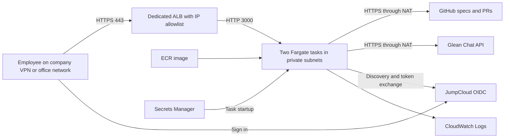

# Internal Specs AWS Deployment Master Plan

Status: **Preparing the user-authorized read-only test deployment without SSO**

Prepared: **2026-10-21**

Service URL: **https://internal-specs.wyze.com**

Deploy AI Spec Explorer as a company-internal service in AWS account
`012619468172`, using the existing shared VPC and ECS cluster. Access requires
an approved company network and, for normal operation, JumpCloud sign-in. GitHub stores the
specifications; Glean supplies the initial model integration. No database is
required.

**User approved execution on 2026-10-21.** Follow the phases in order and update the execution checklist with
results. Routine implementation and deployment steps within the approved scope
can proceed without repeated permission requests. Existing repository reviews,
DNS production approvals, unavailable credentials, and material scope changes
remain separate dependencies.

**Testing amendment, approved 2026-10-21:** the user requested secret fields to
fill in and temporary SSO disablement. Deploy `AuthMode=test-readonly` behind
the unchanged VPN/office allowlist. Block all repository mutations and OIDC
login/callback routes; permit spec reads and model calls once credentials are
configured. The app may start with empty integration fields, explicitly showing
setup status. The runtime secret now contains a generated session key and empty
GitHub, Glean, and future OIDC fields. This amendment permits the test service
and DNS PR to proceed before JumpCloud setup; full-release criteria below still
apply when returning to `AuthMode=oidc`.

## Approved decisions

| Item | Decision | Status |
| --- | --- | --- |
| AWS account and VPC | `012619468172`, `vpc-07faa997b84444780` | User selected |
| Hostname | `internal-specs.wyze.com` | User selected |
| DNS delivery | PR in `wyzelabs-inc/wyze-dns-config` | User selected |
| Region and runtime | `us-west-2`, ECS Fargate in `wyze-internal` | Approved baseline |
| Network access | Internet-facing ALB restricted to company VPN and office egress IPs; private tasks | Approved baseline matching existing services |
| Authentication | JumpCloud OIDC by default; temporary VPN-only read-only test mode | User authorized temporary SSO disablement |
| Contributor access | Assigned JumpCloud users can read and propose changes across all registered teams | Approved by user |
| Spec repository | `wyzelabs-inc/KB-Spec-explorer`, `specs/`, branch `main` | Approved baseline |
| Compiler | Glean; company-knowledge second opinion disabled initially | Approved baseline |
| Persistence | GitHub files, history, PRs, and issues; signed session cookies | Existing architecture |
| Initial capacity | Two tasks, each 0.5 vCPU and 1 GiB RAM | Starting size to validate |
| Infrastructure | CloudFormation, separate foundation and service templates | Approved baseline |

A different
spec repository or compiler remains possible through configuration. Per-team
user permissions are not implemented today: team path restrictions constrain
where an operation writes, but do not decide which employees may edit a team.
If that distinction is required for launch, revise the access design first.

## Verified deployment environment

Read-only AWS inspection on 2026-10-21 verified the target account using profile
`012619468172_AWSAdministratorAccess`. The VPC is owned by that account and is
managed by an existing Control Tower CloudFormation stack. Import its resource
IDs into this deployment; leave ownership of the network with that stack.

| Resource | Verified value |
| --- | --- |
| VPC | `vpc-07faa997b84444780`, CIDR `172.31.0.0/16` |
| ECS cluster | `wyze-internal`, active, supports Fargate |
| ACM certificate | `arn:aws:acm:us-west-2:012619468172:certificate/e61b355c-c98b-4783-ba8d-272d30ae84b9` |
| Certificate coverage | `*.wyze.com`, issued, renewal eligible; expires 2027-01-27 |
| Outbound connectivity | Available NAT gateway in each of three AZs; S3 gateway endpoint |
| DNS ownership | No Route 53 hosted zones in this account; DNSControl repository manages Cloudflare |
| Selected hostname | Resolver returned `NXDOMAIN`; absent from the inspected local DNS configuration |

Use the first two AZs initially. The third remains available for expansion.

| AZ | Private task subnet | Public ALB subnet |
| --- | --- | --- |
| `us-west-2a` | `subnet-06b338c1440dbb2fe` | `subnet-0a51f4bb0e2f2638d` |
| `us-west-2b` | `subnet-06b5d9cd8e4361625` | `subnet-0986aff5d00b4a2a8` |
| `us-west-2c` | `subnet-03edf942c3457d9f1` | `subnet-09e24889d3126eff4` |

Existing ALBs restrict ingress using public VPN/office egress addresses. No
Client VPN endpoint or private VPN route was found in this VPC during inspection.
The proposed ALB therefore uses public subnets with an IP allowlist. Revalidate
the approved address list before creation instead of copying every exception
from another application's security group.

## Architecture and external connections

| Connection | Purpose and credentials |
| --- | --- |
| GitHub REST API | Read specs/history; create branches, commits, PRs, and issues. Fine-grained service token restricted to the selected repository with Contents, Pull requests, and Issues read/write permissions. |
| Glean Chat API | Compile supplied specs and answer questions. Use OAuth client credentials or an API token, never both. Validate the configured spec-only agent in the actual tenant. |
| JumpCloud OIDC | Employee authentication and change attribution. Requires application assignment, issuer, client ID/secret, and the exact callback URI. |
| ECR, Secrets Manager, CloudWatch | Image pull, secret injection, and application logs through the ECS execution role. |
| Amazon Bedrock | Optional future compiler alternative; requires a verified model and scoped task-role permissions. No Bedrock permissions are needed for the Glean baseline. |

There are no direct Confluence, Jira, or Slack integrations. If enabled later,
Glean's company-knowledge lookup accesses those sources through Glean. There is
no RDS, DynamoDB, Redis, vector database, EFS, or application S3 bucket to create.
An operational S3 bucket stores ALB access logs with a 30-day expiry.
Editor drafts remain browser state until checked in. Sessions use signed cookies
and a common signing secret across tasks; sticky sessions are unnecessary.

## Runtime and resource configuration

Use `internal-specs` as the service/resource name prefix and
`/internal-specs/prod` as the secret-name prefix. Create a dedicated ALB, target
group, task security group, execution role, task role, ECR repository, service,
and log group. A rotating service KMS key protects the runtime secret, application
logs, and ECR images; ALB access logs use a private S3 bucket. Reuse the cluster,
network, NAT gateways, and ACM certificate.

| Setting | Initial value |
| --- | --- |
| Container | Existing Node.js 22 standalone Docker image, `linux/amd64`, non-root |
| ECS | Fargate Linux platform 1.4.0 or later; `awsvpc`; public IP disabled |
| Capacity | Desired count 2; 512 CPU units and 1024 MiB memory per task |
| Routing | HTTPS 443 to target type `ip`, HTTP port 3000; unexpected hosts receive a fixed rejection |
| Security groups | ALB ingress only from approved company CIDRs; task ingress only from ALB SG on 3000 |
| Outbound | HTTPS through existing NAT for GitHub, Glean, JumpCloud, and AWS service endpoints |
| Deployment | Rolling, minimum healthy 100%, maximum 200%; circuit breaker with rollback |
| Health | Local `/api/healthz` checks in both ECS task definition and ALB; 60-second startup grace initially |
| Request timing | Enforced 120-second total application request budget; ALB idle timeout 180 seconds |
| Shutdown | Drain in-flight requests during replacement; validate deregistration delay and task stop timeout against the request budget |
| Logs | `/ecs/internal-specs`, 30-day retention, no credentials or full spec/prompt bodies |

The request budget is now enforced by the API wrapper and propagated to GitHub
and model requests, including retries and optional knowledge lookup. Downstream
work is cancelled on expiry or client disconnect. Verify Node connection timeouts
behind the ALB. Next.js route `maxDuration` declarations alone are not a reliable
deadline for this standalone deployment.

Configure health checks explicitly in the ECS task definition; ECS does not
monitor a Dockerfile-only check. Use target type `ip` for the task network mode.
The proposed ALB timeout increases the default of 60 seconds to accommodate the
bounded model work. See [ECS health checks](https://docs.aws.amazon.com/AmazonECS/latest/developerguide/healthcheck.html),
[ALB integration](https://docs.aws.amazon.com/AmazonECS/latest/developerguide/alb.html),
and [ALB timeout configuration](https://docs.aws.amazon.com/elasticloadbalancing/latest/application/edit-load-balancer-attributes.html).

Use separate IAM roles for task execution and application access. Scope secret
reads to this service's secret ARNs and KMS decrypt permissions where applicable.
The Glean application task role needs no model invocation permissions. Deployment
automation must verify the account and region and use scoped deployment
credentials rather than embedding the local administrator profile in CI.

### Application configuration

| Variable | Value or source |
| --- | --- |
| `NODE_ENV` | `production` |
| `APP_BASE_URL` | `https://internal-specs.wyze.com` |
| `AWS_REGION` | `us-west-2` |
| `COMPILER_PROVIDER` | `glean` |
| `GLEAN_INSTANCE` | `wyze` |
| `GLEAN_AGENT` | Existing spec-only `GPT` setting, subject to successful tenant validation |
| `GLEAN_COMPANY_KNOWLEDGE` | `false` |
| `GITHUB_OWNER` / `GITHUB_REPO` | `wyzelabs-inc` / `KB-Spec-explorer` |
| `SPEC_ROOT` / `SPEC_DEFAULT_TEAM` | `specs` / `services` |
| `SPEC_PARENT_PATH` / `SPEC_BASE_BRANCH` | `specs/services/parent.md` / `main` |
| `ALLOW_DIRECT_COMMIT` | `false` |
| `OIDC_ALLOWED_EMAIL_DOMAINS` | `wyze.com`, combined with restricted JumpCloud application assignment |
| `OIDC_ISSUER` / `OIDC_CLIENT_ID` | From the service's JumpCloud application |
| Secret values | `GITHUB_TOKEN`, `OIDC_CLIENT_SECRET`, `SESSION_SECRET`, and the chosen Glean credential |

Register `https://internal-specs.wyze.com/api/auth/callback` with JumpCloud.
Generate a strong session secret of at least 32 random bytes and keep the same
value across replicas. Store secrets through a secure provisioning path, not
CloudFormation plaintext parameters, committed files, shell command arguments,
or PR descriptions. Inject values through ECS secret references. Restart tasks
after rotation, as described in [AWS secret injection](https://docs.aws.amazon.com/AmazonECS/latest/developerguide/secrets-envvar-secrets-manager.html).
Changing the session signing secret invalidates existing sessions.

## Inputs to resolve during implementation

Plan approval can precede credential provisioning. Continue independent work
while resolving these dependencies, but do not launch with placeholder values.

| Input | Status / required before |
| --- | --- |
| Individual service owner and Wyze email for DNS ownership | Default to current operator `cxu@wyze.com`; parameterized |
| Current approved VPN/office egress CIDRs | Verified six US VPN/office `/32` rules against the existing roadmap ALB; recorded in `infra/foundation.yaml`. Overseas access remains outside the initial baseline. |
| JumpCloud application, permitted assignees, issuer, and credentials | Required before enabling normal authenticated operation; deferred for the authorized read-only test phase |
| GitHub service token and confirmation of repository access | Secure location requested from user; required before service launch. Operator GitHub CLI access works and is not the runtime credential. |
| Glean credential and successful spec-only agent call | Secure location requested from user; required before service launch and tenant validation |
| Approved sandbox repository and separately scoped test credentials | Requested from user; required before write-path acceptance |
| Existing operational alert destination | User/service owner to supply before notification acceptance; the account contains only an unrelated staging SNS topic, which was not reused |
| DNS code-owner review and production environment approval | Required by the DNS repository after the healthy-service checks |

The DNS repository's existing process requires another code owner's review and
the `dns-production` environment approval. This plan does not replace those
controls. Request missing inputs only when they are not available from authorized
configuration or connected sources; never ask for secrets to be pasted into chat.

## Ordered execution phases

### Phase 0 Review and approve the plan

- Review the decisions, access policy, resource sizing, and implementation scope.
- Record the user's approval and any amendments here.
- Begin implementation only after approval.

Completion: approval is recorded and the baseline is unambiguous.

### Phase 1 Confirm deployment inputs

- Verify STS identity, VPC/subnet IDs, cluster, certificate, and available quotas.
- Check the latest DNS repository for hostname conflicts and current PR rules.
- Resolve the input table and verify the selected spec directory exists on `main`.
- Check existing repository automation before adding deployment tooling.
- Estimate incremental costs using current prices: two Fargate tasks, the ALB,
  logs, secrets, image storage, NAT traffic, and Glean usage. Existing NAT hourly
  charges are shared costs; this deployment creates no additional NAT gateway.

Completion: configuration is recorded without secret values; unresolved inputs
have an owner and a specific dependent step.

### Phase 2 Prepare the application

- Require valid authentication configuration at production runtime startup.
  Image builds must still work without runtime secrets. Allow unauthenticated
  local development only through an explicit development setting.
- Enforce authentication on spec reads, history/list/team endpoints, Ask,
  compilation, and every write route. Include the currently unguarded
  `/api/spec/init` route. Leave only health, login/callback, minimal auth status,
  and necessary sign-in assets accessible without a session.
- Show a sign-in screen before loading protected data. Keep authorization in
  server handlers and test rejected requests before any GitHub or model call.
- Preserve user attribution, PR-only changes, SHA conflict checks, rule citations,
  and team path containment. Enforce same-origin checks on state-changing requests.
- Add `/api/healthz` with no external network calls or sensitive configuration.
- Fix the Bedrock-only Ask bug: check whether optional Glean knowledge is enabled
  before requiring Glean credentials, and keep optional lookup failures isolated.
- Implement and test the total request deadline and cancellation behavior.
- Key authenticated rate limits by validated user identity rather than trusting
  caller-supplied forwarding headers. Keep the limiter process-local for launch
  and document that two replicas do not enforce a single global quota.
- Review and remediate applicable dependency findings. The initial production
  dependency audit reported three high-severity affected packages: `postcss`,
  `sharp`, and `source-map-js`. Recheck advisories and dependency paths; avoid
  blind forced upgrades. Scan the final container as well.
- Update `.env.example`, deployment documentation, and Docker build exclusions,
  including `.next-verify`. Correct stale provider references in Docker comments.

Completion: focused auth, origin, timeout, provider, and health tests pass, along
with `npm run lint`, `npm run typecheck`, `npm test`, and `npm run build:verify`.
The container builds without secrets, starts with valid runtime settings, and
rejects incomplete production configuration.

### Phase 3 Prepare infrastructure and release tooling

- Add `infra/foundation.yaml` for service-owned ECR, ALB/listener/target group,
  security groups, IAM roles, secret containers, and logs. Accept existing network
  and certificate IDs as parameters. Create secret containers without dummy values.
- Add `infra/service.yaml` for the task definition, ECS service, and alarms. Pass
  foundation outputs explicitly and reference an immutable image digest.
- Add repeatable validation/build/deploy commands under `tools/`. Include account
  checks, deployment status, rollback commands, and outputs for the DNS PR.
- Add CI checks following repository conventions. Use GitHub OIDC and a scoped
  AWS role if CI deployment is configured; use the verified SSO profile for the
  initial operator-driven release. Do not add static AWS keys.
- Validate templates and inspect CloudFormation change sets before execution.
  Confirm they create service resources without replacing shared infrastructure.

Completion: application and infrastructure changes are reviewable in a focused
PR, checks pass, and the build/deploy/rollback commands are documented. Follow
the repository's actual branch and merge requirements.

### Phase 4 Provision foundation and publish the image

- Execute the reviewed foundation change set and record resource outputs.
- Populate the service secrets securely and verify their metadata and required
  keys without printing values.
- Build the tested commit for `linux/amd64`, tag it with the Git commit SHA, scan
  it, push to ECR, and record the resulting digest.
- Verify secret access, outbound connectivity, and scoped execution-role access.

Completion: foundation resources exist, secrets are populated, and a tested,
scanned image digest is available. No DNS record points users to the service yet.

### Phase 5 Start the service and verify infrastructure

- Deploy the service stack with two tasks and the recorded image digest.
- Confirm both tasks and ALB targets become healthy in separate AZs.
- From an approved company network, test the intended hostname against the ALB
  using a temporary client-side connection override that preserves TLS hostname
  validation. No local DNS override is part of the production setup.
- Verify health, TLS, expected host handling, protected API rejection, logs, and
  task replacement. Confirm tasks have no public IPs or direct public ingress.
- Confirm an off-network client cannot reach the ALB.

Completion: network and container checks pass. Full browser OIDC verification
waits for real DNS; it is not inferred from health checks.

### Phase 6 Deliver DNS through a PR

- Start from current `main` in `wyzelabs-inc/wyze-dns-config` and edit only the
  relevant `dnsconfig.js` record.
- Add `internal-specs` as a CNAME to the actual ALB DNS name, with a trailing dot,
  `TTL(300)`, an individual owner comment, and Cloudflare proxy disabled.
- Follow the repository's current validation and preview instructions. Ensure the
  DNS plan contains only this intended addition.
- Open the PR with the hostname, real target, owner, rationale, and rollback.
- Follow code-owner review and the existing approved CI apply path. Do not perform
  a local DNS push or substitute an unreviewed Cloudflare UI change.

Completion: the DNS PR has passed the required workflow and the hostname resolves
to the intended ALB. AWS `*.wyze.com` TLS is valid for the browser connection.

### Phase 7 Verify integrations and release

- Sign in through JumpCloud at the real hostname. Verify callback, cookies,
  logout, unassigned-user rejection, and access to all protected API families.
- Verify GitHub spec listing, reads, history, and Glean-backed answers with valid
  rule citations. Confirm optional company-knowledge lookup remains disabled.
- Temporarily use an approved sandbox repository and its separately scoped token
  for end-to-end branch/PR, upload/init, gap-issue, conflict, and attribution tests.
  Then deploy the production repository configuration and repeat read/auth checks.
  Do not create test issues or change production specs during smoke tests.
- Exercise a request longer than 60 seconds, timeout cancellation, two-replica
  sessions, task replacement, and a failed rollout that retains healthy tasks.
- Confirm CloudWatch alarms for unavailable targets, elevated errors, sustained
  CPU/memory pressure, and failed deployments. Validate log redaction and retention.
- Record the production image digest, task definition revision, stack outputs,
  DNS/application PR links, verification evidence, and unresolved limitations.

Completion: acceptance criteria pass and the service owner can use the service
and the operational runbook. Observe an initial 30-minute period for errors,
latency, memory pressure, and provider failures before declaring the release done.

## Acceptance and rollback

The release is complete when all of the following are demonstrated:

- Company-network access works; off-network access is blocked.
- Unauthenticated callers cannot read specs, invoke models, or mutate GitHub.
- JumpCloud sign-in works at the final hostname and across both task replicas.
- GitHub and Glean functions pass real integration checks; sandbox writes have
  correct attribution and production changes remain PR-only.
- Health checks, timeout handling, logs, alarms, replacement, and rollback work.
- Shared services and their security groups/listeners remain unchanged.
- DNS changes and production outputs are recorded, and launch blockers are closed.

For later releases, roll back to the previously recorded task definition and
image digest, then reconcile CloudFormation to that version. ECS circuit-breaker
rollback requires a previously successful deployment; the first deployment has
no known-good service revision. If the first launch fails, keep DNS unpublished
or remove its new record through the DNS PR workflow and return the service to
zero tasks while correcting the failure.

Infrastructure rollback does not revert GitHub content. Revert unintended spec
changes through a reviewed GitHub PR. Rotate compromised secrets and replace
tasks; session-secret rotation signs users out. Prevent dangling DNS by removing
the record and verifying its removal before deleting the ALB. Retain shared
network resources, the certificate, and the cluster throughout rollback.

## Execution checklist

| Phase | Status | Evidence |
| --- | --- | --- |
| 0 Plan review | Complete | User approval on 2026-10-21 |
| 1 Confirm inputs | Complete with tracked dependencies | Account/network/cluster/certificate/quota and GitHub/DNS rules verified; credential and notification dependencies recorded above; cost baseline in runbook |
| 2 Application preparation | Complete | 394 tests, lint, typecheck, verification build, standalone and AMD64 container smoke pass |
| 3 Infrastructure and tooling | Complete; advisory review tracked | [Draft PR #1](https://github.com/wyzelabs-inc/KB-Spec-explorer/pull/1); CI checks pass on the deployed foundation commit; scanner dispositions are recorded in the runbook |
| 4 Foundation and image | Foundation complete; test-mode image in preparation | Stack is UPDATE_COMPLETE and IN_SYNC; runtime secret initialized with generated session key and empty provider fields |
| 5 Service infrastructure checks | Preparing read-only test deployment | SSO temporarily disabled by user; provider credentials may be added after startup |
| 6 DNS PR and application | Waiting for healthy service | Hostname remains NXDOMAIN; DNS PR has not been opened |
| 7 Integrations and release | Waiting for service, DNS, and sandbox inputs | Live authentication, provider calls, sandbox writes, off-network denial, replacement, rollback, and observation remain pending |

Approval record: **Approved by the user on 2026-10-21: “looks good, let get start.”** Update each phase with its commit/PR, relevant AWS
outputs, test results, and remaining dependencies as execution progresses.

### Validation evidence, 2026-10-21

- Temporary test mode passes 39 access-boundary tests, 3 deployment-secret tests,
  and production standalone smoke checks. Missing provider keys permit the
  workspace to load; all six mutation routes and OIDC login/callback return 403.
  Normal OIDC startup and anonymous-denial tests still pass.
  [Test-mode screenshot](deployment-test-readonly.png) shows the SSO/credential banner.

- `npm run lint`, `npm run typecheck`, and `npm test`: pass, 394 tests in 21 files.
- `npm run build:verify`: passes without runtime credentials using Next.js 15.5.28.
- `python3 tools/smoke-production.py --dist .next-verify`: incomplete production
  settings and production auth bypass terminate startup; configured test server
  returns health 200, sign-in HTML, and 401 for protected read/model/write APIs.
  Fake local settings test structural startup only, not external integrations.
- `cfn-lint` 1.58.0, AWS template validation, Python compilation, and
  `git diff --check`: pass.
- Production dependency audit: zero critical/high/moderate, two low findings
  in the Mermaid/KaTeX dependency path. Full development audit has additional
  tooling findings; see the runbook. The first container scan identified
  CVE-2026-85091 in Alpine's `zlib 1.3.2-r0`; the patched candidate installs
  `1.3.2-r1`. The replacement scan completed with zero OS findings, and the unused
  vulnerable candidate was removed from ECR. Alpine records that fixed version in its
  [security database](https://secdb.alpinelinux.org/v3.24/main.json).
- Browser inspection confirms the sign-in screen loads its assets and calls only
  the minimal auth-status endpoint before login. [Screenshot](deployment-sign-in.png).
- AMD64 container builds without credentials. At 0.5 vCPU and 1 GiB, it serves
  health, sign-in HTML, and static assets with 200, rejects protected APIs with
  401, runs as UID 1001, excludes development tooling, and rejects invalid
  production startup settings. Real upstream integration is still pending.
- Initial foundation change set `review-1792606134`: 12 service-owned additions,
  no shared-resource changes. Superseded before execution to add KMS encryption,
  deletion protection, ALB access logs, and security-rule descriptions in response
  to CI findings. The revised template contains 16 service-owned resources.

### Provisioned foundation and release candidate

| Item | Recorded value |
| --- | --- |
| Foundation stack | `internal-specs-foundation`, `UPDATE_COMPLETE` |
| Stack ID suffix | `71fc1260-cd7c-11f1-9312-02e37fe28139` |
| Drift check | `IN_SYNC`, zero drifted resources |
| ALB resource name | `wyze-internal-specs` (AWS reserves the `internal-` name prefix) |
| ALB DNS target | `wyze-internal-specs-1589150793.us-west-2.elb.amazonaws.com` |
| Runtime secret | `/internal-specs/prod/runtime`; ARN suffix `runtime-eddM1Z`; generated session key; other credential fields empty pending user input |
| Application logs | `/ecs/internal-specs`, 30-day retention, service KMS key |
| ALB access logs | `internal-specs-alb-logs-012619468172-us-west-2`, 30-day expiry; log-delivery test file verified |
| Release commit | `88f65ac8e748177e2b4220054fa1d3a1b9fad91e` |
| Candidate image | `012619468172.dkr.ecr.us-west-2.amazonaws.com/internal-specs@sha256:c727a39040d083e8384643f84e15c2ebcca7172539915631e7728f967c089519` |
| Candidate scan | COMPLETE, zero ECR basic OS findings; production npm audit separately retains two low findings |

AWS checks verified the exact six allowed ingress CIDRs, HTTPS-only listener,
ALB-to-task security-group isolation, KMS encryption/rotation, log delivery,
and scoped secret access. IAM simulation permits the execution role to read
this service's secret and denies an unrelated secret. Actual task secret
retrieval and outbound provider connections await the service launch.

A client connection override preserving `internal-specs.wyze.com` validates TLS
and reaches the ALB. The service host returns 503 with no targets; an unexpected
Host header returns 404. This is foundation evidence, not a passing application
health check. Public DNS still returns NXDOMAIN.

Provisioning recovered from two AWS validation failures: a reserved ALB name and
an overly restrictive log-delivery policy. The five retained service resources
were imported into the current stack before adding the remaining eleven. The
final policy uses AWS's account/region delivery scope and its service-principal
exception for redacted network context. The stack now has no drift; no shared
network, cluster, certificate, or existing application resources were changed.

The release image was built and tested from `88f65ac`; subsequent documentation
commits record deployment evidence and do not change that image. Application,
infrastructure, CodeQL, secret scanning, and Lacework SCA checks pass for that
commit. Wiz's advisory result and the remaining infrastructure scanner review
are visible in PR #1. No real GitHub/Glean/OIDC integration success is claimed.

## References

- [Application architecture and setup](../README.md)
- [Current authentication behavior](../lib/auth/require-user.ts)
- [Protected initialization route](../app/api/spec/init/route.ts)
- [Optional Glean lookup configuration](../lib/providers/glean-knowledge.ts)
- [DNS repository and workflow](https://github.com/wyzelabs-inc/wyze-dns-config)
